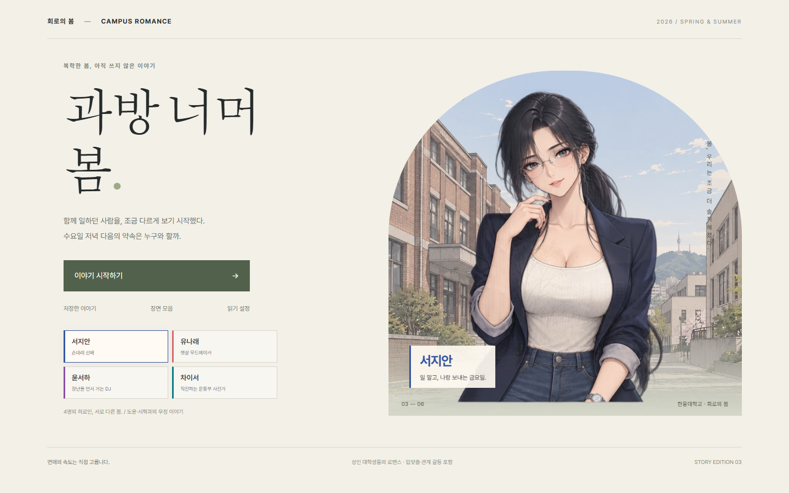
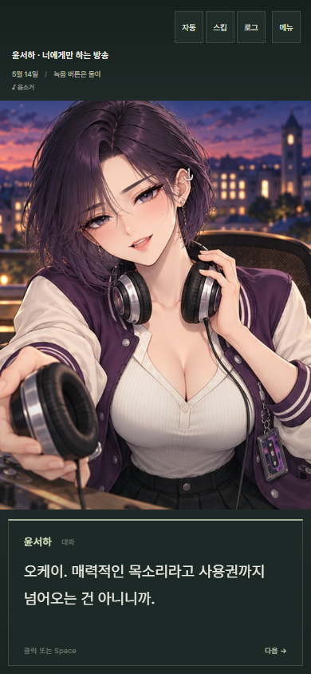

# 과방 너머 봄 · Campus Romance

> 함께 일하던 사람을, 조금 다르게 보기 시작했다. 수요일 저녁 다음의 약속은 누구와 할까.

한울대학교 공학 동아리 **회로의 봄**에서 시작하는 한국어 캠퍼스 로맨스 비주얼 노벨. 24세 복학생이 프로젝트·축제·일상 속에서 연애와 우정, 자신의 생활을 고릅니다.

**[지금 플레이하기 →](https://choijunhuk.github.io/campus-romance/)**

[개편 기록](docs/REDESIGN.md) · [아트 제작 기록](docs/ART_DIRECTION.md) · [사운드트랙](docs/SOUNDTRACK.md) · [스토리 작성 규약](src/data/SCHEMA.md)



## Story Edition 03 · v0.3

**4명의 히로인, 9곡의 테마, 서로 다른 봄.** 미연시풍 캐릭터 디자인과 표정을 새로 만들고, 방송부·운동장까지 캠퍼스를 넓혔습니다.

| 인물 | 함께 보내는 봄 | 구성 |
| --- | --- | --- |
| 서지안 · 24세 | 자신감 있는 공대 선배. 일 말고 함께 보내는 금요일 | 본편 14씬 + 분기 2씬 |
| 유나래 · 22세 | 장난기 있는 디자이너. 좋아하는 것을 같이 만드는 사이 | 본편 14씬 + 분기 2씬 |
| 윤서하 · 23세 | 먼저 다가오는 방송부 DJ. 방송 밖에서 듣고 싶은 목소리 | 본편 14씬 + 분기 2씬 |
| 차이서 · 21세 | 직진하는 운동부 사진가. 기록 없는 날에도 같이 한 바퀴 | 본편 14씬 + 분기 2씬 |
| 한도윤 · 21세 | 서로의 기여를 인정하는 우정·개발 프로젝트 | 5씬 |
| 정시혁 · 24세 | 진로와 밴드 활동을 함께 응원하는 우정 | 5씬 |

공통 루트 8씬과 결말 19개를 포함해 **101씬·614노드**입니다. 공통 루트에서 네 히로인을 만나고, 연애 4개·우정 2개·솔로 중 직접 고릅니다. 선택한 데이트 활동과 대화 방식은 방문 장면과 이후 대사에 남습니다. 타이틀의 인물 버튼은 미리 보기이며 루트를 확정하지 않습니다.

모든 인물은 성인 대학생입니다. 호감과 장난, 질투와 갈등, 관계 공개, 입맞춤과 그 뒤의 약속까지 다룹니다. 가까워지는 속도를 늦추어도 좋은 결말에 도달할 수 있습니다. 공식 연령 등급을 부여받은 작품은 아닙니다.

## 장면과 음악

- 히로인별 **6표정·총 24개**, 투명 스프라이트, 배경 17장, 본편 이벤트 CG 8장.
- 인물별 컷신 모음과 결말 기록. 실제 방문한 장면만 해금됩니다.
- 리듬과 멜로디가 있는 **오리지널 BGM 9곡**. 일상 로파이·데이트 재즈·밤 네오소울·고백 피아노·긴장곡과 네 히로인 테마.
- 지안의 펑크 재즈, 나래의 보사노바, 서하의 시티팝, 이서의 기타 팝. 장면의 내용에 따라 곡이 바뀝니다.
- 곡 전환 페이드·반복·음량·음소거·현재 곡 제목 표시. 대사마다 곡이 처음부터 재생되지 않습니다.

음악은 작성된 모티프와 편곡을 MIDI로 만들고, 실제 악기 샘플로 렌더링했습니다. 제작 도구·악기 출처·재현 방법은 [SOUNDTRACK.md](docs/SOUNDTRACK.md)에 있습니다. 게임 실행에는 API나 음악 생성 서비스 구독이 필요하지 않습니다.



## 플레이 기능

- 자동 진행, 읽은 대사 스킵, 선택 기록이 포함된 대사 로그, 관계 소개.
- 자동 저장 1개·수동 슬롯 3개, 덮어쓰기 확인, 선택 이력과 컷신 복원.
- 글자 크기 16–26px, 대사 속도·자동 대기·음량 설정, 모션 줄이기 반영.
- 관계 수치는 기본 숨김이며 설정에서 켤 수 있습니다.
- 모바일 세로·가로 화면 대응, 키보드 조작, 메뉴 포커스 관리.

| 조작 | 동작 |
| --- | --- |
| 클릭 / Space / Enter | 대사 전체 보기 또는 다음 대사 |
| A | 자동 진행 |
| Ctrl | 스킵 전환 |
| H | 대사창 숨김·복귀 |
| Esc | 메뉴 닫기 / 숨긴 UI 복귀 / 메뉴 열기 |
| 숫자 1–7 | 현재 선택지 선택 |
| 백틱 키 | 개발용 진행 정보 |

자동 진행과 스킵은 선택지에서 멈춥니다. 기본 설정에서는 읽지 않은 대사를 건너뛰지 않습니다. 저장·설정·장면 해금은 브라우저 localStorage에 보관되며 기기 간 자동 동기화되지 않습니다.

**이전 저장 안내:** 공통 루트의 노드 구성이 달라 v0.1·v0.2 저장을 불러오지 않습니다. 수동 슬롯은 직접 덮어쓰지 않는 한 보관됩니다. 새로 시작하면 자동 저장은 v0.3 진행으로 바뀝니다. 기존 장면 해금 기록은 유지됩니다.

## 로컬 실행

**Node.js 24 이상**이 필요합니다. 실행에 API 키는 필요하지 않습니다.

```bash
git clone https://github.com/choijunhuk/campus-romance.git
cd campus-romance
npm ci
npm run dev
```

기본 개발 주소는 `http://localhost:5173`입니다.

| 명령어 | 용도 |
| --- | --- |
| `npm run validate` | 씬·분기·플래그·CG·에셋 참조 검사 |
| `npm test` | 엔진·실제 스토리 경로·저장/복원·음악 수명 검사 |
| `npm run build` | 콘텐츠 검증 → TypeScript 검사 → 배포용 빌드 |
| `npm run preview` | 빌드 미리 보기 |
| `npm run test:e2e` | 브라우저에서 네 연애 루트·저장·갤러리·음악·반응형 검사 |
| `npm run story:build` | 작성 원본에서 씬 JSON과 설정 재생성 |
| `npm run art:pack` | 원본 아틀라스에서 배경·CG 추출 및 WebP 패킹 |
| `npm run art:check` | 이미지 디코딩·해상도·투명도·6표정 아틀라스 검사 |
| `npm run music:compose` | 모티프·편곡에서 MIDI 원본 재생성 |
| `npm run music:render` | FluidSynth·SoundFont·FFmpeg로 음원 렌더링 |
| `npm run audio:check` | 9곡 디코딩·길이·음량·중복·루프 경계 검사(FFmpeg 필요) |

브라우저 테스트를 처음 실행할 때 `npx playwright install chromium`을 실행하세요. 설치된 Chrome은 `PLAYWRIGHT_CHANNEL=chrome` 환경 변수로 선택합니다. CI는 Node 24에서 이미지·오디오 검사, 단위 테스트, 빌드, Chromium 플레이 검사를 실행합니다.

## 개발 구조

```text
src/components/           타이틀·플레이·저장·설정·갤러리
src/data/scenes/          씬 JSON
src/data/characters.json  인물·연애/우정 역할·디자인
src/data/world_bible.json 학번·휴학·일정·작품 톤
src/data/routes.json      경로·결말·플래그
src/data/art.json         실제 이미지 목록
src/data/soundtrack.json  곡명·BPM·파일·길이
src/engine/              분기·조건 대사·화면 상태·배경음·테스트
src/store.ts             진행·저장·설정
scripts/write-story.mjs   스토리 작성 원본
scripts/story-expansion.mjs 서하·이서와 공통 만남 작성 원본
scripts/compose-score.mjs 9곡의 모티프·화성·악기·리듬 편곡
scripts/prepare-art.mjs   아틀라스 추출·WebP 패킹
art/source/              아트 원본 PNG, 배포에는 포함하지 않음
audio/source/            재편곡 가능한 오리지널 MIDI
public/assets/art-v2/    본편 WebP
public/assets/bgm-v3/    본편 BGM
e2e/                    브라우저 테스트
```

React 18 · Vite 8 · TypeScript · Zustand · Zod 4 · CSS · Vitest · Playwright.

스토리는 두 작성 스크립트를 수정한 뒤 `npm run story:build`로 재생성합니다. JSON만 고치면 재생성 때 덮어써집니다. 세부 규약은 [SCHEMA.md](src/data/SCHEMA.md)에 있습니다. 예전 이미지 생성기와 v0.1 에셋은 보관되어 있으며 본편의 이미지 목록은 `art.json`이 기준입니다.

## 배포

`master` push 시 [GitHub Pages 워크플로](.github/workflows/deploy.yml)가 `/campus-romance/` 기준으로 빌드·배포합니다. 브랜치와 PR 변경은 병합 후 플레이 링크에 반영됩니다.
